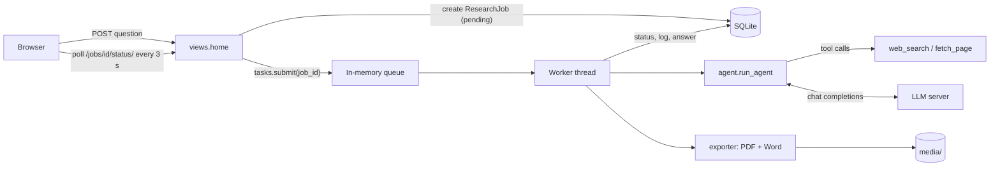

# Web Research Agent (Django)

A multi-user Django web app built around a local-LLM research agent. A user asks a
question; the agent searches the web (DuckDuckGo), reads the most relevant pages, and
writes a summary with a list of sources. The answer can be downloaded as **PDF** and
**Word** files.

By default it talks to a local [Ollama](https://ollama.com) server (`qwen3:4b`), but it works
with any OpenAI-compatible API.

---

## Table of contents

- [Features](#features)
- [How it works](#how-it-works)
- [Project structure](#project-structure)
- [Requirements](#requirements)
- [Installation](#installation)
- [Choosing a model](#choosing-a-model)
- [Configuration](#configuration)
- [Usage](#usage)
- [URLs](#urls)
- [Data model](#data-model)
- [Security](#security)
- [Deploying to the internet](#deploying-to-the-internet)
- [Known limitations](#known-limitations)
- [Troubleshooting](#troubleshooting)
- [Extending the project](#extending-the-project)
- [License](#license)

---

## Features

- Log in / sign up, with every user seeing only their own research.
- Ask a question in the browser; the request returns instantly and the work runs in a
  background thread.
- Live progress: the job page polls the server every 3 seconds and shows each tool call
  the agent makes.
- Agent with two tools: `web_search` (DuckDuckGo) and `fetch_page` (download a page and
  extract readable text).
- The agent answers in the language of the question and finishes with a "Sources" list.
- Download the result as PDF or Word (`.docx`).
- Terminal mode: `python manage.py ask "your question"`.
- Django admin for browsing and filtering jobs.
- Built-in limits: concurrent jobs per user, jobs per day, job timeout, optional
  sign-up switch.
- SSRF protection for page downloads, and owner-only file downloads.

## How it works



1. The user submits a question (5–500 characters). The view checks the per-user limits,
   creates a `ResearchJob` and puts its id on an in-memory queue.
2. A daemon worker thread picks the job up, checks that the model server is reachable
   (`check_setup`), and runs the agent loop.
3. **Agent loop** (`research/agent.py`): the model is called with the tool definitions. If
   it asks for tools, they are executed and the results are sent back. This repeats for up
   to `RESEARCH_MAX_STEPS` steps. If the limit is hit, the model is called once more with
   tools disabled and asked to write its best answer from what it gathered.
4. Every tool call is appended to the job's `log`, which the browser shows live.
5. The final answer is cleaned (any leaked `<think>…</think>` block is removed), saved as
   PDF and Word under `media/research/<user_id>/<job_id>/`, and the job is marked `done`.
   Any failure marks the job `error` with a readable message.

## Project structure

```
research_site/
├── manage.py
├── requirements.txt
├── .env.example               # template for your local .env
├── .gitignore
├── config/                    # Django project
│   ├── settings.py            # reads everything from .env
│   ├── urls.py                # /admin/, /accounts/, and the research app
│   ├── asgi.py
│   └── wsgi.py
├── research/                  # the app
│   ├── agent.py               # LLM client, tools, agent loop
│   ├── tasks.py               # background queue and worker threads
│   ├── security.py            # SSRF protection (assert_public_url)
│   ├── exporter.py            # markdown-ish answer -> PDF and DOCX
│   ├── models.py              # ResearchJob
│   ├── views.py               # home, job detail, status, download, signup
│   ├── forms.py               # QuestionForm
│   ├── urls.py
│   ├── admin.py
│   ├── migrations/0001_initial.py
│   ├── management/commands/ask.py   # terminal mode
│   └── templates/research/    # base.html, home.html, job.html
└── templates/registration/    # login.html, signup.html
```

## Requirements

- Python 3.10 or newer (the code uses modern type syntax such as `tuple[str, bool]`).
- A running LLM server with an OpenAI-compatible API and **tool-calling support**. The
  default is Ollama.
- Internet access for the machine running the server (web search and page downloads).

Python packages (`requirements.txt`):

| Package | Used for |
|---|---|
| `Django>=5.2,<7` | Web framework |
| `openai>=1.40` | Client for Ollama / any OpenAI-compatible server |
| `requests` | Downloading pages |
| `beautifulsoup4` | Extracting readable text from HTML |
| `ddgs>=9.0` | DuckDuckGo search |
| `python-dotenv` | Loading `.env` |
| `reportlab` | PDF export |
| `python-docx` | Word export |

## Installation

### Windows (PowerShell)

```powershell
python -m venv venv
venv\Scripts\activate
python -m pip install -r requirements.txt

copy .env.example .env          # then edit .env (set DJANGO_SECRET_KEY at least)

python manage.py makemigrations research
python manage.py migrate
python manage.py createsuperuser
python manage.py runserver
```

### macOS / Linux

```bash
python3 -m venv venv
source venv/bin/activate
python -m pip install -r requirements.txt

cp .env.example .env            # then edit .env

python manage.py makemigrations research
python manage.py migrate
python manage.py createsuperuser
python manage.py runserver
```

### Start the model server

With Ollama:

```bash
ollama pull qwen3:4b            # or the model you set in LLM_MODEL
```

Make sure Ollama is running, then open <http://127.0.0.1:8000/> and log in.

## Choosing a model

`qwen3:4b` is the default because it is light, but a larger model usually follows the
tool-calling loop and writes summaries better. To switch, pull the model and change one
line in `.env`:

```
LLM_MODEL=qwen3:14b
```

Pick a size that fits your GPU memory (or RAM): roughly 8B-class models for 8 GB, 14B-class
for 12–16 GB, and 30B-class (for example the `qwen3:30b-a3b` MoE) for 24 GB or 32 GB of
unified memory. Whatever you choose, the model must support tool calling. `check_setup()`
verifies that the model exists on the server before every job.

**Context window.** The agent keeps every fetched page in the conversation, so the context
grows with each step. If a model seems to forget the instructions or ignore earlier pages,
raise Ollama's context size by creating a model variant:

```
# Modelfile
FROM qwen3:14b
PARAMETER num_ctx 16384
```

```bash
ollama create qwen3-14b-16k -f Modelfile
```

and set `LLM_MODEL=qwen3-14b-16k`.

**Other providers.** Set `LLM_BASE_URL`, `LLM_MODEL` and `LLM_API_KEY` to point at any
OpenAI-compatible endpoint. The agent already retries on rate-limit errors.

## Configuration

Everything is configured through environment variables in `.env`. `.env` holds your real
values and is git-ignored; `.env.example` is the committed template. When you add a new
setting, add it to `.env.example` too.

| Variable | Default | Meaning |
|---|---|---|
| `DJANGO_SECRET_KEY` | insecure dev key | Django secret key. **Required** when `DJANGO_DEBUG=False` (the app refuses to start otherwise). |
| `DJANGO_DEBUG` | `True` | Debug mode. Must be `False` in production. |
| `DJANGO_ALLOWED_HOSTS` | `localhost,127.0.0.1` | Comma-separated host names the site may be served on. |
| `TIME_ZONE` | `UTC` | Django time zone, e.g. `Asia/Tehran`. (Not in `.env.example`; add it if you need it.) |
| `LLM_BASE_URL` | `http://localhost:11434/v1` | OpenAI-compatible endpoint. |
| `LLM_MODEL` | `qwen3:4b` | Model name on that server. |
| `LLM_API_KEY` | `ollama` | API key (Ollama ignores it, but the client needs a value). |
| `RESEARCH_MAX_STEPS` | `6` | Maximum tool-calling rounds per job. |
| `RESEARCH_MAX_PAGE_CHARS` | `4000` | Characters of text kept from each fetched page. |
| `RESEARCH_WORKERS` | `1` | Jobs that run at the same time. Keep it low for a local model. |
| `RESEARCH_MAX_ACTIVE_PER_USER` | `2` | Unfinished jobs allowed per user. |
| `RESEARCH_MAX_PER_DAY` | `20` | Jobs per user in the last 24 hours. |
| `RESEARCH_JOB_TIMEOUT_MINUTES` | `20` | After this time an unfinished job is marked failed. |
| `RESEARCH_ALLOW_SIGNUP` | `True` | Set to `False` to allow only admin-created users. |

Fixed values in code (`research/agent.py`): max 2 MB downloaded per page, 5 redirects,
15 s fetch timeout, 300 s LLM request timeout, `max_tokens=4000`, 1–8 search results per
query, and 3 attempts per LLM call on rate-limit or invalid tool-call errors.

## Usage

### In the browser

1. Open <http://127.0.0.1:8000/> and log in (or sign up if it is enabled).
2. Type a question and press **Start research**. You are taken to the job page.
3. Watch the agent's steps appear. When the job finishes, the page reloads with the answer
   and the **Download PDF** / **Download Word file** buttons.
4. The home page lists your 15 most recent jobs.

The agent replies in the language of the question, and the page renders text with
`dir="auto"`, so Persian and other right-to-left languages display correctly in the
browser. See [Known limitations](#known-limitations) for PDF export.

### From the terminal

```bash
python manage.py ask "What are the main differences between SQLite and PostgreSQL?"
```

Prints each step, then the answer, and saves PDF and Word files in `./outputs/`.
No login or database job is involved.

### Admin

Open <http://127.0.0.1:8000/admin/> with the superuser account. The `ResearchJob` list
shows user, question, status and timestamps, with filters and search.

## URLs

| URL | Name | Purpose |
|---|---|---|
| `/` | `research:home` | Ask a question, list recent jobs |
| `/signup/` | `research:signup` | Create an account (404 if sign-up is disabled) |
| `/jobs/<id>/` | `research:job` | Job page: answer, downloads, live log |
| `/jobs/<id>/status/` | `research:status` | JSON `{status, label, log}` used for polling |
| `/jobs/<id>/download/<pdf\|docx>/` | `research:download` | Download a generated file (owner only) |
| `/accounts/login/`, `/accounts/logout/`, … | Django auth | Login, logout (POST), password change |
| `/admin/` | Django admin | Administration |

## Data model

`research.ResearchJob`

| Field | Description |
|---|---|
| `user` | Owner (foreign key to the user model) |
| `question` | The question text |
| `status` | `pending`, `running`, `done` or `error` |
| `log` | Agent steps, one per line, updated while the job runs |
| `answer` | Final answer text |
| `error` | Error message if the job failed |
| `pdf_path`, `docx_path` | File paths relative to `MEDIA_ROOT` |
| `created_at`, `finished_at` | Timestamps |

Jobs that never finish (server restarted, worker crashed) are closed lazily by
`expire_if_stale()` whenever they are viewed or counted, so they cannot block a user's
active-job limit forever.

## Security

- **SSRF protection** (`research/security.py`): before every download and every redirect
  hop, the host is resolved and the request is refused unless all addresses are public
  (no localhost, private networks, link-local or cloud-metadata addresses). Only `http` and
  `https` are allowed.
- **Prompt-injection stance:** the system prompt tells the model that web content is
  untrusted data and must never be treated as instructions. This reduces, but cannot fully
  remove, the risk with small local models.
- **Owner-only access:** job pages, status and downloads all look the job up by
  `pk` *and* `user`. Downloads also verify that the resolved path stays inside `MEDIA_ROOT`.
  Generated files are never served directly from the media folder.
- **Output escaping:** answers are rendered through Django's auto-escaping as plain text.
- **Abuse limits:** active-job cap, daily cap, question length limit, and an optional
  switch to close public sign-up.
- DNS rebinding can still defeat the SSRF check in theory. For high-risk setups, run the
  server in a network that cannot reach your internal services.

## Deploying to the internet

The defaults are meant for local use. Before exposing the site:

- [ ] Set `DJANGO_DEBUG=False`, a long random `DJANGO_SECRET_KEY`, and `DJANGO_ALLOWED_HOSTS`.
- [ ] Serve it with a production server behind HTTPS (for example `gunicorn` on Linux or
      `waitress` on Windows). **Run a single process**, because the job queue lives in memory.
- [ ] Consider setting `RESEARCH_ALLOW_SIGNUP=False` and creating users yourself.
- [ ] Decide how to serve static files. The pages use inline CSS, but the Django admin
      needs `STATIC_ROOT` plus `collectstatic` or a package such as WhiteNoise when
      `DEBUG=False`; neither is configured yet.
- [ ] Add HTTPS-related Django settings (secure cookies, HSTS, redirect to HTTPS) as
      appropriate for your host.
- [ ] Use a real database such as PostgreSQL if you expect many users.
- [ ] For several server processes, replace `tasks.submit` with a Celery task (with
      Redis) that calls `_run(job_id)`.
- [ ] Back up `db.sqlite3` and `media/`.

## Known limitations

- **PDF is English only.** The built-in PDF font supports Latin-1 characters; anything else
  (for example Persian) is replaced with `?`. The Word export is not affected. Fixing the
  PDF means registering a Unicode TTF font in `exporter.py` and handling right-to-left
  shaping.
- **In-memory job queue.** Jobs waiting in the queue are lost when the server restarts
  (they are later marked failed), and the queue works for one server process only.
- **The timeout marks, it does not kill.** `RESEARCH_JOB_TIMEOUT_MINUTES` changes a stale
  job's status, but does not interrupt a thread that is still running.
- **Plain-text answers.** The browser shows the model's markdown as plain text.
- **SQLite** is used by default; it is fine for one process and light use.
- **Search depends on DuckDuckGo** via the `ddgs` package, which can rate-limit or change
  without notice.
- **Small models are unreliable.** `qwen3:4b` may produce invalid tool calls, empty answers
  or shallow summaries. Use a larger model for better results.
- The login page always shows a "Create one" link, even when sign-up is disabled (the link
  then leads to a 404).

## Troubleshooting

| Symptom | What to check |
|---|---|
| "Cannot reach the model server at …" | Is Ollama running? Is `LLM_BASE_URL` correct? |
| "Model '…' not found on the server" | Run `ollama pull <LLM_MODEL>`. |
| "The API key was rejected" | Check `LLM_API_KEY` in `.env`. |
| "The model returned an empty answer" | Retry or rephrase; try a larger model or a larger context. |
| Job stays on *Waiting* | `RESEARCH_WORKERS` slots are busy with another job, or the server was restarted (the job will expire and be marked failed). |
| "You already have research running" | Wait for your active jobs to finish, or raise `RESEARCH_MAX_ACTIVE_PER_USER`. |
| `ImproperlyConfigured: Set DJANGO_SECRET_KEY…` | `DJANGO_DEBUG=False` needs a real `DJANGO_SECRET_KEY`. |
| "Blocked: this address is not on the public internet." | The agent tried to fetch a local or private address; this is the SSRF protection working. |
| `no such table: research_researchjob` | Run `python manage.py migrate`. |

## Extending the project

- **Add a tool:** write a function in `research/agent.py`, add its schema to `TOOLS`, and
  register it in `TOOL_FUNCTIONS`. Return text, and raise on errors; `run_tool` sends errors
  back to the model so it can recover.
- **Change the agent's behavior:** edit `SYSTEM_PROMPT` in `research/agent.py`.
- **Change the answer format:** the exporter understands headings (`#`–`###`), bullets,
  `**bold**` and markdown links; extend `parse()` / `save_pdf()` / `save_docx()` in
  `research/exporter.py`.
- **Scale the queue:** replace `tasks.submit()` with Celery; the work itself is the
  `_run(job_id)` function.

## License

No license has been chosen yet. Add a `LICENSE` file before publishing the project.
